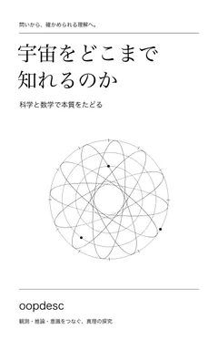
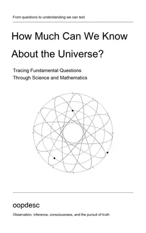
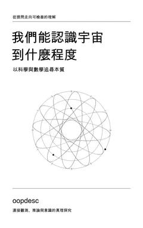

# 宇宙をどこまで知れるのか

科学と数学で本質をたどる。著者 **oopdesc**。2026年10月27日、日本語初版。

## 各言語の版

| 表紙 | 無料で読む | Kindle版 |
| --- | --- | --- |
|  | [日本語で読む](ja/README.md) | [Amazon.co.jpで見る](https://www.amazon.co.jp/dp/B0HPMLP5N3) |
|  | [Read in English](en/README.md) | Amazonで審査中 |
|  | [閱讀繁體中文](zh-Hant/README.md) | Kindle販売ページは準備中 |

表紙 © 2026 oopdesc。掲載用に縮小し、WebPに変換しました。[原著と利用条件](NOTICE.md)

遠くの宇宙から届く光を、どこまで確かな知識にできるのか。観測、推論、数学、哲学の境目を確かめながら、宇宙の本質を探ります。結論から本文の根拠へ移動できる構成です。

前作『すべての存在の幸福を考える』とは別の書籍です。日本語初版を原文とし、英語・繁体字中国語の全文と図版を収録しています。

[本の一覧](../../README.md#books) · [利用と原著の表示](NOTICE.md) · [日本語初版の訂正](ERRATA.md) · [版の記録](PROVENANCE.json)
