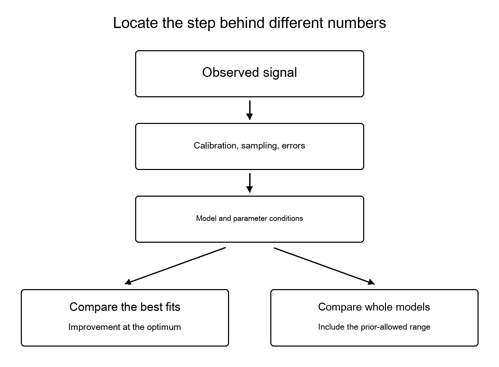

# Chapter 4. Is Cosmic Acceleration Changing?

Two questions help clarify dark energy. What components or gravitational behavior must we assume to explain cosmic expansion? And do those components or behaviors change over time? Research in 2026 examines the second question more closely than before, but change has not been established.

## A Ruler for Expansion History

Interactions between matter and light in the early universe left traces of waves. Those traces survive in later distributions of astronomical objects. Baryon acoustic oscillations, or BAO, provide a way to compare distance scales at different epochs.

This is not a ruler held against the sky to read off centimeters. Distributions in angle and redshift constrain combinations of distance and expansion rate. The constraints depend on how the ruler’s reference length is treated and how other observations are combined.

Light from distant quasars carries fine patterns of absorption by intervening hydrogen. Collecting many such spectra and studying their correlations gives information about the geometry of the early-to-intermediate universe. We see not merely photographs of small points of light, but cosmic structure inscribed along light’s path.

## New DESI Measurements

A 2026 DESI paper uses correlations in the absorption known as the Lyman-alpha forest to constrain geometry precisely at an effective redshift of 2.33. In a two-parameter model of evolving dark energy, it reports a 2.7σ preference when DESI is combined with the microwave background, and 3.2σ when supernovae are also included.[5]

This does not establish that the cosmological constant is wrong. The paper also explains that the new high-redshift measurement itself agrees well with the reference Planck ΛCDM model; preference for evolution arises in fits combining measurements from other epochs. Saying every new measurement pushes in the same direction would misrepresent the result.[5]

These distinctions may seem small. Yet there is a difference between announcing that our understanding of the universe has changed and explaining which account fits a little better under which conditions. The latter lets others carry the research forward.

## The Strengths and Limits of Specifying a Shape

To investigate change, we must represent how something changes. Excessive freedom cannot be constrained by limited data. But imposing an overly simple form risks finding the best answer within that form when reality changes differently.

Wang and Freese represent dark energy density or its equation of state at selected redshifts and interpolate between them. They report results consistent with a cosmological constant and discuss how the assessed significance of evolution depends on the representation. Submitted and revised in 2025, the work appeared in JCAP in 2026.[6]

“Model-independent” in the title does not mean assumption-free. Flatness, selected observations, interpolation, and prior conditions remain. This analysis also excludes supernovae. Its numbers cannot be placed beside different DESI combinations and counted as simple votes for or against.[6]

Rather than immediately declare a winner, I take this as a reason to locate the differences. Which observations are shared? Which information is newly added? What kinds of evolution are allowed? Without aligning these conditions, we cannot understand what disagreement between papers means.

DESI itself also tests more than one two-variable formula. Extended analyses compare binned representations and Gaussian-process methods.[47] It is therefore premature to dismiss hints of evolution as merely an illusion caused by choosing one formula. We need to examine how far comparisons across representations have already gone and how their datasets differ.

## Adding Observations and Correcting Calibration

Even with the same supernovae, changes to photometric standards or models relating color and distance can change distance estimates. The 2026 DES-Dovekie reanalysis updated cross-calibration and error treatment. Support for evolution weakened relative to the earlier analysis; the adopted combination produced a weak Bayes factor of about five to one.[41]

This is not simply a case of newly found objects outnumbering old results. It reflects changes in the process connecting observations to distances. No instrument provides a direct, unmediated route from a measured number to a property of the world. Better calibration also advances understanding.

A 2026 preprint by Watkins and colleagues focuses instead on systematic offsets between nearby and distant supernovae and examines consistency with the standard model.[43] It is an unreviewed analysis involving small-sample comparisons, not a resolution of every problem. The degeneracy between distance normalization and the Hubble constant also matters. A normalization from a supernova fit cannot simply be compared with an independent absolute measurement of that constant.

## Three Sigma and Inconclusive Evidence

A 2026 analysis by Lozano Torres reports both improved fits for evolving models and inconclusive Bayesian model comparisons using combinations that include updated supernova data.[42] These answer different questions: how much the best-fitting parameters improve a fit, and how strongly a model is supported after considering its entire prior-allowed range, are not the same quantity.

The Bayesian comparison also depends on the chosen priors and the evidence estimate under them. We cannot line up sigma values from papers using different datasets and choose the largest. [Chapter 12](12_evidence.xhtml) uses a simple calculation to show why model comparisons can change even when the best fit stays the same.

## Another Route Through Gravitational Lensing

The Hubble constant expresses the present expansion rate. Values inferred by fitting early-universe observations to a reference model differ from those obtained from comparatively recent cosmic observations. This discrepancy is called the Hubble tension.

An October 2026 TDCOSMO preprint uses time delays between images of quasars produced by 11 gravitational lenses, among other information. Its reference analysis assumes flat ΛCDM and a matter-density condition derived from supernova data. It reports 71.1, with upper and lower uncertainties of 2.4 and 2.3 kilometers per second per megaparsec.[7]

This does not simply reuse the local distance ladder. But it is also inaccurate to call it independent of all other observations. Explicitly stating the external conditions in the reference result matters. A related discussion paper compares combinations excluding other measurements and concludes that lensing alone still needs greater precision to adjudicate the tension.[8]

These are measurement and discussion papers from the same research, not two independent discoveries. Paper counts should not automatically become evidence counts.

## The Frontier Is Not a Shelf of Finished Answers

These studies do not show mere stagnation in which nothing can be decided. More observations are compared, sources of error are treated more closely, and model flexibility is examined. We see more precisely where an explanation is supported and what could change that support.

Yet a 2026 date alone does not make a paper more trustworthy than all earlier research. Adding observations, reanalyzing the same observations, and proposing an untested method serve different roles. The frontier is also a place where unfinished scrutiny is made public, not a shelf of settled answers arranged newest first.

Identifying dark energy matters for the universe’s future. Extrapolating constraints from a limited span of cosmic history into the distant future, however, requires accepting the assumptions of that extrapolation. Many bridges remain between a hint of change and a definite account of the universe’s end.
