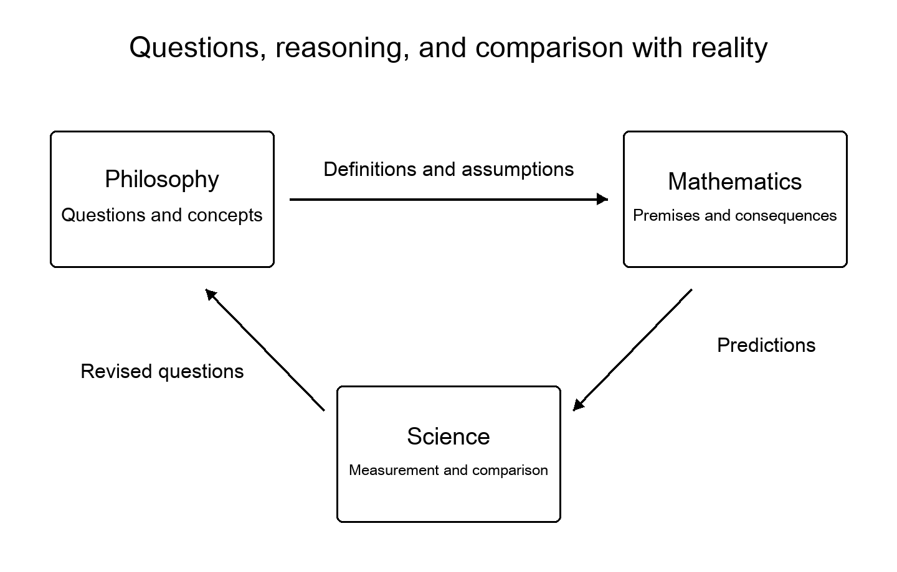

[Read the opening conclusions](00_conclusions.md#h-1) ｜ [Contents](../README.md#toc) ｜ [References](19_references.md#h-1) ｜ [Next chapter](01_truth.md#h-1)

# Introduction: The Conclusions First

We cannot yet close the question of the universe’s essence with a single answer. That does not mean we know nothing. By reading light arriving from far away, measuring atoms, and investigating the brain, we have learned to distinguish explanations we once could not tell apart. The effort to understand the universe has already brought us this far.

What matters most to me in this book is not the grandeur of an answer, but where it meets the world. Which observations led to this conclusion? What would be different under another explanation? What can we then say about consciousness or the meaning of a life? Following these connections brings even immense questions a little closer.

Philosophy opens questions that do not yet have a definite shape. Mathematics examines what follows from stated assumptions. Science compares explanations with measurement and experiment. Rather than set the three against one another, I want to draw on each in pursuing truth. In the later chapters, we follow probability, conservation laws, and causation through small calculations.

Here is the outline of the book.

## Seven Things We Can Say Now

**First, our knowledge of cosmic history is not an improvised story.** We compare light spectra, the cosmic microwave background, and the distribution of astronomical objects through physical models. Yet a model-based estimate of the universe’s age differs from asking why anything exists at all. [Chapter 2](02_cosmos.md) explores this distinction.

**Second, major components of the universe remain unidentified.** Dark matter and dark energy are also names for places where an explanation is needed. Naming them does not solve them; it narrows what must be explained. [Chapter 3](03_dark_matter.md) and [Chapter 4](04_dark_energy.md) include new results from 2026.

**Third, quantum theory has experimentally challenged our everyday picture of the world.** It has not proved that consciousness makes the universe obey our wishes, or that distant people share a single mind. [Chapter 6](06_quantum.md) separates experimental constraints from interpretation.

**Fourth, genuinely deep problems remain where gravity meets quantum theory.** Observations of black holes, calculations about information, and proposals for experiments are different kinds of evidence. Drawing in part on papers published in October 2026, [Chapter 7](07_gravity.md) and [Chapter 8](08_information.md) examine their assumptions.

**Fifth, explanations of consciousness are gradually being tested.** Whether indicators developed for brains can measure subjective experience when transferred to AI remains unresolved. [Chapter 10](10_consciousness.md) and [Chapter 11](11_ai.md) distinguish intelligence, fluent conversation, and consciousness.

**Sixth, laws describing the universe do not automatically supply the purposes we ought to uphold.** I want to reduce avoidable severe suffering and widen people’s room to choose how to live. In [Chapter 13](13_meaning.md), I present that wish as a proposal whose reasons we can discuss, rather than as a command from the universe.

**Seventh, approaching fundamental questions requires preserving not only conclusions but also the conditions under which they would change.** This does not mean settling for weak answers. It means identifying the steps we can responsibly take. [Chapter 14](14_inquiry.md) and the chapters that follow develop practical ways to do this.

## What I Mean by “Essence”

In this book, essence is not a magical word that explains everything. I use it for **the question of what is preserved when explanations at different scales are connected, and where new assumptions become necessary**. This is my approach to inquiry, not a definition of essence proved by physics.

The behavior of atoms, changes in temperature, and an organism’s experience of cold are not unrelated. But would writing equations for atoms automatically complete an explanation of feeling cold? If we could explain that experience, would an obligation to help a person suffering from cold follow from the same equations? Connection and completed explanation are different things.

We can retain those connections while noticing where bridges have yet to be built. That is where this book begins its pursuit of the universe’s essence.

## Where This Question Began

In my previous book, *Considering the Happiness of All Beings*, I explored a philosophy of refusing to push anyone’s experience beyond the bounds of concern.[[39]](19_references.md#ref-39) Its origin lay in my own long suffering, and in the time I spent continuing to ask how the world might be better understood.

Keeping that purpose in mind, I now turn the questions outward. What is the universe like? Why do we, as parts of it, have experiences? What could greater understanding enable us to change? I do not offer my wishes as evidence that I am right. I want to bring the questions those wishes inspired closer to forms that others can examine.

This book consists of reflections comparing existing research and philosophical proposals of my own. It is neither a report of observing a new astronomical object nor a paper proving a final theory of the universe. I do not claim to have performed independent experiments or comprehensively reanalyzed the raw data. For that reason, I distinguish what a study shows from what I think about it.

## Reading and Sharing

To begin with cosmology, turn to [Chapter 2](02_cosmos.md); for consciousness and AI, begin with [Chapter 10](10_consciousness.md). If you are uncertain about interpreting numbers, you may prefer to read [Chapter 12](12_evidence.md) first. Each chapter links back to the conclusions and contents. Numbered citations lead to the references.

The original text and editorial work are shared under CC BY-SA 4.0 to the extent of rights held by the author, oopdesc. Commercial use and adaptation are permitted. Identify the author, title, edition, source, and changes; share adaptations under the same terms.[[40]](19_references.md#ref-40) This permission does not extend to rights in third-party papers or figures. See the [colophon](20_colophon.md) for details.

I would be glad if these questions could continue to grow beyond my hands while their origin remains recorded alongside my name.

---

[Read the opening conclusions](00_conclusions.md#h-1) ｜ [Contents](../README.md#toc) ｜ [References](19_references.md#h-1) ｜ [Next chapter](01_truth.md#h-1)
