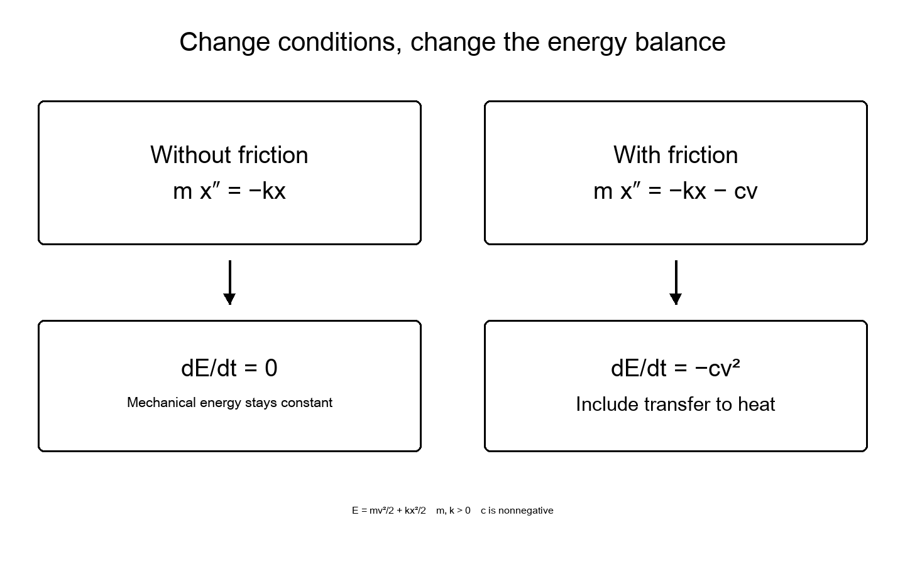

[Read the opening conclusions](00_conclusions.md#h-1) ｜ [Contents](../README.md#toc) ｜ [References](19_references.md#h-1) ｜ [Previous chapter](14_inquiry.md#h-1) ｜ [Next chapter](16_causality.md#h-1)

# Chapter 15. Using Mathematics to Find What Persists Through Change

Seeking the universe’s essence, we may look for something unchanging behind appearances. Physics has made part of that desire concrete. What is conserved, under which conditions? Which relationships preserve their form? What changes when the conditions are removed?

We begin with a small spring—not to picture the universe as a spring, but to practice connecting definitions, predictions, tests, and limits. Then we turn to conservation laws and cosmic expansion.

## Numbers Come with What They Count

Adding a length of 2 to a time of 3 produces no well-defined physical quantity of 5. Length comes with units such as meters and time with seconds. Physical relationships should retain their meaning when units change. The International System of Units supplies common standards.[[58]](19_references.md#ref-58)

Checking dimensions detects some equation errors. Speed is length divided by time; acceleration divides by time again. Matching dimensions does not make a law correct, however. Coefficients and functional forms must also be determined and compared with observation.

Prose logic has a parallel: incompatible kinds of terms do not connect as they stand, but compatible kinds do not guarantee a true overall claim. Dimensional analysis is a useful first test, not a sufficient condition.

## Motion Predicted by a Spring

Take a mass m attached to a spring with spring constant k along a line. Let x be displacement from equilibrium, t time, and v velocity. Assume positive constant m and k, no friction or external force, and extensions small enough for force −kx. Then

**m d²x/dt² = −kx**

The negative sign gives a restoring force toward equilibrium. One solution has the form

**x(t) = A cos(ωt + φ), ω² = k/m**

A is amplitude and φ the phase specifying the initial state. Differentiating twice multiplies the cosine by −ω² and recovers the equation. The period T for returning to the same position and velocity is therefore

**T = 2π √(m/k)**

For m = 1 kilogram and k = 4 newtons per meter, T = π seconds, about 3.14 seconds. These numbers specify a model, not a measurement.

“It oscillates” has become a testable prediction under changed conditions. Quadrupling mass while holding k fixed doubles the period. Changing amplitude does not change it within this ideal model. If a real spring violates the latter prediction, we can ask whether extension is too large or neglected effects matter.

Mathematics did not establish the assumptions experimentally. It made their consequences less ambiguous, creating a point of comparison with reality.

## Checking Conservation by Calculation

Define the model’s energy as

**E = mv²/2 + kx²/2**

The first term is kinetic energy and the second spring potential energy. Their shares vary with position. What happens to their sum?

Since v = dx/dt, differentiation gives

**dE/dt = mv dv/dt + kx dx/dt = v(m d²x/dt² + kx) = 0**

The last equality uses the initial equation of motion. Differentiation, the definition of velocity, and the equation lead to conservation. The definition of energy alone did not produce it.

Now add friction −cv opposing velocity, with c ≥ 0. The right side of the motion equation becomes −kx − cv. The same calculation yields

**dE/dt = −cv² ≤ 0**

This E for the mass and spring decreases. Including the physical surroundings receiving friction, the lost mechanical energy passes into heat and other forms. What belongs inside or outside the system determines the scope of a conservation statement.

## Symmetry and Conservation Laws

The form of a law may remain unchanged whether an experiment starts today or tomorrow, or is translated or rotated. Noether’s first theorem connects continuous symmetries of this kind with conserved quantities. Under suitable conditions for action-based mechanics, time translation connects to energy, spatial translation to momentum, and rotation to angular momentum.[[53]](19_references.md#ref-53)[[52]](19_references.md#ref-52)

It opens a common mathematical route through seemingly separate conservation laws. Extending it to “any symmetry immediately gives a conservation law” loses necessary conditions. The second theorem, concerning local symmetries that can vary from place to place, instead has a role involving identities among equations of motion.

Barros e Sá and colleagues’ 2026 paper clarifies additional conditions, such as splitting the action, needed to derive covariant conservation laws from the second theorem.[[52]](19_references.md#ref-52) Ignoring the distinction and saying “symmetry means conservation” hides the very connection we seek.

The theorem’s beauty to me is not a single word explaining everything. It specifies, conditionally, which invariance under change connects to which conservation.

## Moving to an Expanding Universe

Let a(t) be the scale factor. For a large-scale homogeneous and isotropic universe in general relativity, treating components as perfect fluids and including the cosmological constant among them, the acceleration equation is

**(d²a/dt²)/a = −(4πG/3) Σ(ρ + 3p/c²)**

G is the gravitational constant, c light speed, ρ energy density expressed as mass density, and p pressure. Σ sums over the components considered. Do not double-count a cosmological constant also written on the left or as a separate term.[[1]](19_references.md#ref-1)

For a single positive-density component, define w = p/(ρc²). The sign is determined by 1 + 3w. If w < −1/3, that single-component model accelerates. Matter with negligible pressure has w = 0, radiation 1/3, and a cosmological constant treated as a fluid −1. With multiple components, their densities and summed contributions matter, not just one w.

Negative pressure may resist everyday intuition. We can still follow its meaning in the equation and its observational consequences. The equation does not identify dark energy; it shows which combinations observations seek to constrain.

The universe generally lacks the global time-translation symmetry used in the spring example. Local covariant conservation of energy-momentum cannot be equated with defining one conserved total energy for the whole universe. Carrying familiar intuition to cosmology requires mathematics to ask about conditions again.

## Following Essence Through Relationships

This has not explained everything about why laws exist or why these laws hold. We have nevertheless moved beyond watching change to predicting effects of altered conditions and seeking relationships preserved through change.

One route toward understanding the world’s essence may be to connect such relationships within ranges we can check. Rather than name a final entity at the outset, ask what persists as we vary conditions and where it ceases to persist. From there, we can seek explanations deeper than our present models.

---

[Read the opening conclusions](00_conclusions.md#h-1) ｜ [Contents](../README.md#toc) ｜ [References](19_references.md#h-1) ｜ [Previous chapter](14_inquiry.md#h-1) ｜ [Next chapter](16_causality.md#h-1)
