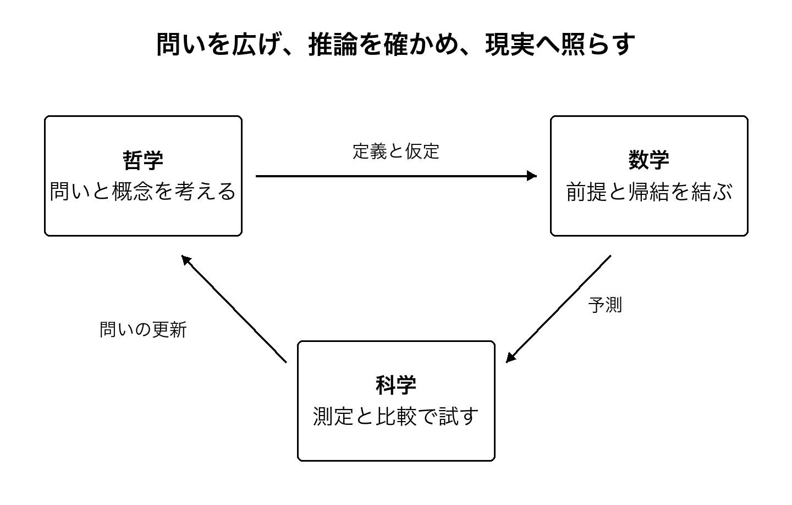

# はじめに 結論を先に読む

宇宙の本質を、いま一つの答えに閉じることはできません。それでも、私たちが何も知らないわけではありません。遠くから届く光を読み、原子を測り、脳の働きを調べることで、以前には区別できなかった説明を区別できるようになりました。宇宙を知る営みは、すでにここまで進んでいます。

この本で私が大切にしたいのは、答えの大きさよりも、答えと世界の接点です。どんな観測からその結論へ来たのか。別の説明なら何が違うのか。そこから、意識や人生の意味について何を言えるのか。この接点をたどれば、途方もない問いを、ただ遠いままにしておかずに済みます。

哲学は、まだ形のない問いを広げます。数学は、置いた前提から何がつながるかを確かめます。科学は、その説明を測定と実験へ照らします。三つを競わせるより、それぞれの力を借りながら、真理を追い求めたいと思います。後半では、確率、保存則、因果関係を、小さな計算からたどります。

本書の見取り図を、先にお伝えします。

## いま言える七つのこと

**第一に、宇宙の歴史についての知識は、思いつきの物語ではありません。** 光のスペクトル、宇宙背景放射、天体の分布などを、物理モデルを介して突き合わせています。ただし、モデルから推定した宇宙の年齢と、存在そのものがなぜあるのかという問いは別です。[第2章](02_cosmos.xhtml)で、この違いを確かめます。

**第二に、宇宙の主要な成分には、まだ正体のわからないものがあります。** 暗黒物質やダークエネルギーは、その場所につけた名前でもあります。名前があるから解決したのではなく、何を説明すべきかが絞られています。2026年の新しい結果も含めて、[第3章](03_dark_matter.xhtml)と[第4章](04_dark_energy.xhtml)で見ていきます。

**第三に、量子論は、私たちの素朴な世界像を実験で問い直してきました。** けれども、意識が宇宙を思いどおりにつくることや、離れた人の心が一つであることを証明したわけではありません。何が実験による制約で、何が解釈なのかを[第6章](06_quantum.xhtml)で分けます。

**第四に、重力と量子論の接点には、本当に深い未解決問題があります。** ブラックホールの観測、情報をめぐる計算、実験の提案は、同じ種類の証拠ではありません。2026年10月に公刊された論文も手がかりに、[第7章](07_gravity.xhtml)と[第8章](08_information.xhtml)で、説明の前提を確かめます。

**第五に、意識については、説明が少しずつ試験にかけられています。** 一方で、脳について得た指標をAIへ移せば、そのまま主観的経験を測れるのかは未解決です。知能の高さ、会話の巧みさ、意識があることを混ぜずに、[第10章](10_consciousness.xhtml)と[第11章](11_ai.xhtml)で考えます。

**第六に、宇宙を記述する法則から、私たちが守るべき目的が自動的に出てくるわけではありません。** 私は、避けられる深刻な苦しみを減らし、互いの生き方を選ぶ余地を広げたいと考えています。その願いを宇宙の命令にせず、理由を話し合える提案として[第13章](13_meaning.xhtml)に置きます。

**第七に、本質へ近づくためには、結論だけでなく、結論が変わる条件を残す必要があります。** これは弱い答えで済ませるという意味ではありません。どの一歩なら確かに踏み出せるかを明らかにする、探究の進め方です。[第14章](14_inquiry.xhtml)以降に、その具体的な方法をまとめました。

## 本質という言葉をどう使うか

本書では、本質を、すべてを説明する魔法の一語としては使いません。**異なる尺度の説明をつないだとき、何が保たれ、どこで新しい前提が必要になるかを探す問い**として使います。これは著者の探究上の立場であり、物理学によって証明された本質の定義ではありません。

たとえば、原子の振る舞いと、温度の変化と、生き物が寒さを感じることは、互いに無関係ではありません。しかし、原子の式を書けば、寒さを感じる経験の説明まで自動的に完成するでしょうか。経験を説明できれば、寒さに苦しむ人を助ける義務も、同じ式から出てくるでしょうか。つながっていることと、説明が済んでいることは違います。

私たちは、そのつながりを失わずに、まだ架かっていない橋を見分けることができます。この本は、そこから宇宙の本質を追いかけます。

## この問いの原点

前作『すべての存在の幸福を考える』では、誰の経験も配慮の外へ押し出さないための哲学を考えました。[39] 原点にあったのは、私自身の長い苦しみと、それでも、世界をもう少し理解したいと考え続けてきた時間です。

今回は、その目的を胸に置きながら、問いを外の世界へ広げます。宇宙はどのようなものなのか。なぜ、その宇宙の一部である私たちに経験があるのか。理解が進めば、何を変えられるのか。私の願いを正しさの証拠にはせず、願いから生まれた問いを、他の人も確かめられる形へ近づけたいと思います。

本書は、既存研究を読み比べた考察と、著者の哲学的な提案から成ります。新しい天体を観測した報告でも、宇宙の最終理論を証明した論文でもありません。独立した実験や原データの全面的な再解析を行ったとも述べません。だからこそ、どの研究が何を示し、そこから私が何を考えたのかを、分けて記します。

## 読み方と共有について

宇宙の研究から読みたい方は[第2章](02_cosmos.xhtml)へ、意識やAIから入りたい方は[第10章](10_consciousness.xhtml)へ進んでください。数字の読み方に不安があれば、先に[第12章](12_evidence.xhtml)を読んでいただいても構いません。各章から結論と目次へ戻れます。本文の番号を押すと、参考文献へ移動します。

独自の本文と編集は、著者oopdescが保有する権利の範囲で、CC BY-SA 4.0により共有します。商用利用や改変も可能です。著者名、書名、版、出典、変更したことを示し、改変して共有するときは同じ条件を引き継いでください。[40] 第三者の論文や図の権利まで、この許諾に含めるものではありません。詳しくは[奥付](20_colophon.xhtml)に記しました。

ここに書いた問いが、私の名前とともに記録されながら、私の手を離れても育っていけばうれしく思います。
