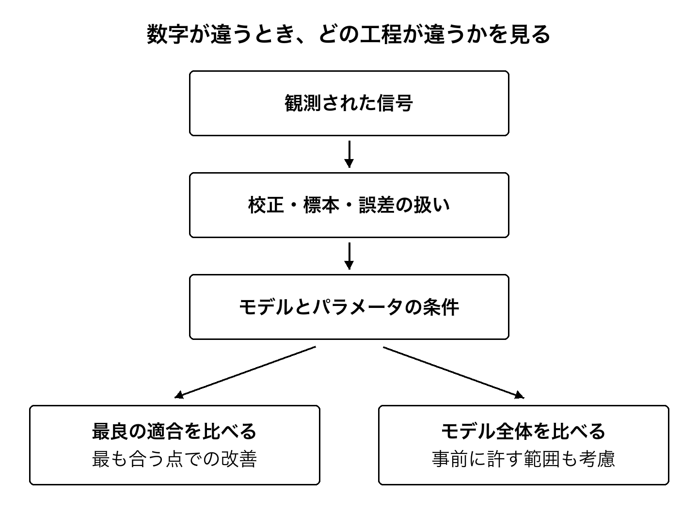

[結論から読む](00_conclusions.md#h-1) ｜ [目次](../README.md#toc) ｜ [参考文献](19_references.md#h-1) ｜ [前の章](03_dark_matter.md#h-1) ｜ [次の章](05_time.md#h-1)

# 第4章 宇宙の加速は変わるのか

ダークエネルギーを考えるとき、二つの問いを分けると見通しがよくなります。宇宙の膨張を説明するため、どんな成分や重力の働きを仮定する必要があるのか。そして、その成分や働きは時代によって変わるのか。2026年の研究は、後者を以前より細かく問うています。けれども、変化が確定した段階とは言えません。

## 膨張の歴史を測る物差し

宇宙の初期には、物質と光の相互作用に伴う波の痕跡ができました。その痕跡は、後の天体の分布などに残ります。バリオン音響振動、略してBAOと呼ばれるこの手がかりを使うと、異なる時代の距離の尺度を比べられます。

ただし、物差しを空へ当てて直接センチメートルを読むような測定ではありません。角度や赤方偏移方向の分布から、距離と膨張率の組合せを制約します。物差しの基準となる長さをどう扱うか、他の観測とどう合わせるかで、得られる制約も変わります。

遠方のクエーサーからの光には、その途中にある水素が光を吸収した細かな模様が残ります。これを多数集めて相関を調べると、初期から中期の宇宙の幾何について情報が得られます。私たちが見ているのは、小さな星の写真だけではなく、光の通り道に刻まれた宇宙の構造でもあるのです。

## DESIの新しい測定

DESIの2026年の論文は、ライマンαの森と呼ばれる吸収の相関を用いて、有効赤方偏移2.33での幾何を精密に制約しています。時変のダークエネルギーを二つのパラメータで表すモデルでは、DESIと背景放射の組合せで2.7σ、超新星も合わせた組合せで3.2σの選好を報告しました。[[5]](19_references.md#ref-5)

これは、宇宙定数が否定されたという結論ではありません。同じ論文の考察では、新しい高赤方偏移の測定点自体は基準となるPlanckのΛCDMとよく整合し、時変モデルへの選好は他の時代の測定を合わせた適合の中で生じることも説明されています。新しい測定がすべて同じ方向へ押していると描くと、実際の内容から離れます。[[5]](19_references.md#ref-5)

このような違いは、読者には細かく見えるかもしれません。しかし「宇宙の常識が変わった」という一文と、「どの条件で、どの説明が少しよく合うのか」という説明の間には、研究を引き継げるかどうかの差があります。

## 形を決めてから探すことの強さと弱さ

変化を調べるには、変わり方を何らかの形で表す必要があります。自由すぎる形を許せば、限られたデータからは絞れません。逆に、単純な形を強く仮定すると、実際には別の変化なのに、その形の中で最も合う答えを探してしまうおそれがあります。

WangとFreeseの研究は、ダークエネルギー密度や状態方程式を赤方偏移のいくつかの点で表し、その間を補間する方法を使います。宇宙定数と整合的な結果を報告し、表し方によって時変の有意さの評価が変わることを論じています。2025年に投稿・改訂され、2026年のJCAPに掲載された研究です。[[6]](19_references.md#ref-6)

論文名にはモデル非依存という語が含まれますが、あらゆる仮定がないわけではありません。平坦性、選んだ観測、補間や事前の条件が残ります。また、この解析では超新星を加えていません。DESIの別の組合せの数字と並べ、単純な賛成・反対の投票として数えることはできません。[[6]](19_references.md#ref-6)

私がここから学ぶのは、どちらかを直ちに勝者とすることよりも、違いの生まれる場所を調べることです。同じ観測を使っている部分はどこか。新しく加えた情報はどこか。どんな変わり方を許したか。これを揃えて比較しないと、論文同士の不一致の意味もわかりません。

なお、DESI側も、単一の二変数の式だけを試しているわけではありません。拡張解析では、区分的な表現やガウス過程を用いる方法も比較しています。[[47]](19_references.md#ref-47) 時変の兆候を、単に「一つの式を選んだための錯覚」と片づけるのも早すぎます。表現を変えた比較が既にどこまで行われ、観測の組合せがどう違うかを読む必要があります。

## 観測を増やすことと、校正を直すこと

同じ超新星を使う場合でも、光の明るさを測る基準や、色と距離の関係を扱う模型が変われば、距離の推定は変わります。2026年のDES-Dovekie再解析は、測光の相互校正や誤差の扱いなどを更新しました。以前の解析より時変への支持が弱まり、採用した組合せでは、およそ5対1という弱いベイズ因子を報告しています。[[41]](19_references.md#ref-41)

これは、新しく見つけた天体が、ただ数で古い結果を打ち消したという話ではありません。観測を距離へ結ぶ工程を直した結果です。どの装置も、測った数から世界の性質へ直通しているわけではない。校正を詳しくすることも、世界についての理解を進めます。

一方、2026年のWatkinsらのプレプリントは、近傍と遠方の超新星の間の系統的なずれへ注目し、標準模型との整合を検討しています。[[43]](19_references.md#ref-43) 小標本の比較を含む未査読の解析であり、すべての問題が解決したと扱うことはできません。距離の規格化とハッブル定数の縮退にも注意が要ります。超新星の当てはめで得た規格化の数字を、そのまま独立した絶対的なハッブル定数の測定と比べることはできません。

## 三σと、決定的でない証拠

Lozano Torresの2026年の解析は、更新された超新星などを含む組合せで、時変模型の適合の改善と、決定的でないベイズ的なモデル比較を併せて報告しています。[[42]](19_references.md#ref-42) 二つは、違う問いへ答えています。最もよく合うパラメータでどれほど改善するかと、事前に許した範囲全体を考慮して、模型をどれほど支持するかは、同じ数ではないからです。

ここでのベイズ比較も、採用した事前分布と、そのもとでの証拠の推定に依存します。別のデータ集合を使う論文のσと一列に並べて、数の大きい方を採ることはできません。[第12章](12_evidence.md)では、同じ最良の適合でもモデル全体の比較が変わる仕組みを、簡単な計算で確かめます。

## 重力レンズがもたらす別の道

宇宙膨張の現在の速さを表す量が、ハッブル定数です。初期の宇宙の観測を基準モデルに当てはめて推定する値と、比較的近い時代の観測から求める値にずれがあり、ハッブル緊張と呼ばれています。

2026年10月のTDCOSMOのプレプリントは、11個の重力レンズで複数に見えるクエーサーについて、光が到着する時間のずれなどを利用しました。基準の解析は、平坦なΛCDMと、超新星データに由来する物質密度の条件を用い、ハッブル定数を71.1、誤差を上側2.4、下側2.3 km毎秒毎メガパーセクと報告しています。[[7]](19_references.md#ref-7)

この値は、局所的な距離の階段をそのまま使ったものではありません。しかし、だからすべての他の観測から独立だと考えるのも正確ではありません。基準結果に何の外部条件を入れたかが示されていることに意味があります。関連する考察論文も、他の測定を除いた組合せを比較しつつ、重力レンズの方法だけで緊張を判定するには、なお精度向上が必要だとしています。[[8]](19_references.md#ref-8)

この二つの論文は同じ研究の測定と考察であり、独立な二回の発見ではありません。論文の本数を、そのまま根拠の本数にしないようにします。

## 最前線は完成品の列ではない

ここまでの研究が示しているのは、何も決まらないという停滞ではありません。比較する観測が増え、誤差の源が詳しく扱われ、モデルに許す自由度も点検されています。ある説明を支持する範囲と、それが動く条件が、より細かく見えてきています。

その一方、2026年という新しい年号だけで、過去のすべての研究より信頼できるとは言えません。観測が増えた論文、同じ観測を別の方法で解析した論文、まだ試していない方法の提案は、それぞれ役割が違います。最前線は、確定した答えが新しい順に並んだ棚ではなく、検討の途中が公開されている場所でもあるのです。

ダークエネルギーの正体を知ることは、宇宙の将来を考えるうえでも重要です。ただ、現在の限られた時代の制約を、はるかな未来まで外挿するなら、その外挿の仮定を引き受ける必要があります。変化の兆候から、宇宙の最期を一つに決めるまでには、まだ多くの橋が残っています。

---

[結論から読む](00_conclusions.md#h-1) ｜ [目次](../README.md#toc) ｜ [参考文献](19_references.md#h-1) ｜ [前の章](03_dark_matter.md#h-1) ｜ [次の章](05_time.md#h-1)
