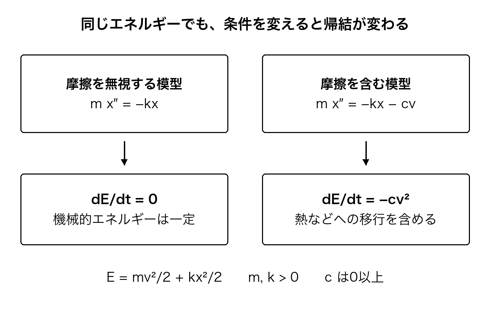

[結論から読む](00_conclusions.md#h-1) ｜ [目次](../README.md#toc) ｜ [参考文献](19_references.md#h-1) ｜ [前の章](14_inquiry.md#h-1) ｜ [次の章](16_causality.md#h-1)

# 第15章 数学で、変化の中に保たれるものを見る

宇宙の本質を考えるとき、私たちは、目に見える姿の奥に変わらないものを求めることがあります。物理学は、その願いの一部を、非常に具体的な問いにしてきました。何が、どんな条件で保存されるのか。形を変えずに成り立つ関係は何か。そして、その条件を外すと、何が変わるのか。

この章では、小さなばねの運動から始めます。宇宙そのものをばねだと考えるためではありません。一つの説明を、定義から予測、検証、限界までつなぐ練習です。そのつながりを持ってから、保存則と宇宙の膨張へ進みます。

## 数には、何を数えたかが付いている

長さ2と時間3を足して5にしても、どんな量の5かが定まりません。長さならメートル、時間なら秒という単位とともに扱います。単位の取り方を変えても、物理的な関係そのものが変わらない形で書けることが重要です。国際単位系SIは、その共通の基準を与えています。[[58]](19_references.md#ref-58)

量の次元を確かめると、式の誤りを一部見つけられます。速さは長さを時間で割ったもの、加速度はさらに時間で割ったものです。ただし、次元が合うだけで正しい法則になるわけではありません。係数や関数の形は、別に決め、観測へ照らす必要があります。

これは、文章の論理にも似ています。言葉の種類が合っていなければ、そのままではつながりません。けれども、種類が合っただけで、主張全体が正しいとは言えない。次元の検査は、十分条件ではなく、よい第一の検査なのです。

## ばねが予測する運動

一直線上で、質量mのおもりを、ばね定数kのばねにつけたとします。つり合いからの変位をx、時間をt、速度をvと書きます。mとkは正で一定、摩擦や外からの力を無視し、小さな伸びで力が−kxになる範囲を考えます。運動方程式は、

**m d²x/dt² = −kx**

です。右辺の負号は、つり合いへ戻す向きに力が働くことを示します。この式を満たす一つの形は、

**x(t) = A cos(ωt + φ)、ω² = k/m**

です。Aは振れ幅、φは初めの状態を表す位相です。二回微分するとcosに−ω²が掛かり、元の運動方程式へ戻ります。したがって、同じ位置と速度へ戻る周期Tは、

**T = 2π √(m/k)**

となります。mが1キログラム、kが4ニュートン毎メートルなら、Tはπ秒、約3.14秒です。ここでの数は模型の設定であり、実測値ではありません。

これで「揺れる」という描写が、変えた条件に応じて確かめられる予測になりました。質量を4倍にし、ばね定数を同じにすれば、周期は2倍になります。振れ幅を変えても、この理想模型の範囲では周期は変わりません。後者が実際のばねで崩れるなら、伸びが大きすぎないか、他の効果を無視できるかを調べます。

数学は、仮定が正しいかを実験抜きで決めたのではありません。仮定を置いたら何が出るかを、曖昧さを減らして示しました。だから、現実と比べる場所ができたのです。

## 保存を、言葉だけでなく計算で確かめる

この模型のエネルギーを、

**E = mv²/2 + kx²/2**

と定義します。初めの項は運動エネルギー、後の項はばねの位置エネルギーです。位置が変わるにつれ二つの配分は変わりますが、合計はどうなるでしょうか。

v = dx/dtなので、時間で微分すると、

**dE/dt = mv dv/dt + kx dx/dt = v(m d²x/dt² + kx) = 0**

となります。最後の等号では、初めに置いた運動方程式を使っています。関数の微分、速度の定義、運動方程式という順で、保存という結論へつながりました。定義だけから保存が出たわけではありません。

今度は、速度と逆向きに−cvという摩擦力を加えます。cは0以上とします。運動方程式の右辺は−kx−cvになり、同じ計算から、

**dE/dt = −cv² ≤ 0**

が出ます。おもりとばねについて書いたこのEは減ります。摩擦の相手も含む物理的な系を考えれば、失われた機械的エネルギーは熱などへ移っています。何を系へ含め、何を外へ置いたかが、保存を語る範囲に関わるのです。

## 対称性と保存則

同じ実験を今日始めても明日始めても、法則の形が変わらない。場所を平行にずらしても、向きを回しても、同じ関係が成り立つ。そのような連続的な対称性と保存量を結びつけたのが、ネーターの第一定理です。作用を用いて記述する力学の適切な条件の下で、時間並進の対称性はエネルギー、空間並進は運動量、回転は角運動量の保存につながります。[[53]](19_references.md#ref-53)[[52]](19_references.md#ref-52)

この関係は、ばらばらに見える保存則を、共通の数学から考える道を開きました。ただし、「どんな対称性でも、そのまま何らかの保存が出る」と広げると、条件を失います。位置ごとに変えられる局所的な対称性を扱う第二定理には、運動方程式間の恒等関係という別の役割があります。

2026年のBarros e Sáらの論文は、第二定理から共変保存則を導くには、作用の分離など追加の条件が必要であることを整理しています。[[52]](19_references.md#ref-52) 第一と第二の違いを無視して「対称性だから保存」とまとめると、まさに知りたい接点を隠してしまいます。

私がこの定理に見たい美しさは、何でも一語で説明できることではありません。どの変化を許しても同じであることが、どの保存へつながるかを、条件つきで明らかにしたところにあります。

## 膨張する宇宙へ進むとき

宇宙の膨張を表す尺度因子をa(t)とします。大きな尺度で一様・等方な宇宙を一般相対論で扱い、成分を完全流体として表すと、加速度の式は、宇宙定数も流体成分へ含める表記で、

**(d²a/dt²)/a = −(4πG/3) Σ(ρ + 3p/c²)**

となります。ここでGは重力定数、cは光速、ρは質量に換算したエネルギー密度、pは圧力です。Σは、考える成分について足すという意味です。宇宙定数を左辺や別項へ置く表記と、二重に数えないようにします。[[1]](19_references.md#ref-1)

単一成分について、w = p/(ρc²)と置き、ρが正なら、右辺の符号に関わるのは1 + 3wです。wが−1/3より小さければ、その成分だけの模型では加速になります。圧力を無視できる物質ならwは0、放射なら1/3、宇宙定数を流体として扱うなら−1です。成分が複数あれば、一つのwだけでなく、それぞれの密度も含めた合計を見ます。

負の圧力という語は、日常の圧力と直感が合いにくいかもしれません。それでも、式の中で何を意味し、どの観測へ関わるかをたどれます。この式は、ダークエネルギーの正体まで決めるものではありません。観測でどんな組合せを絞ろうとしているかを示します。

宇宙全体には、ばねの例で使ったような大域的な時間並進の対称性が一般にはありません。局所的なエネルギー運動量の共変保存と、宇宙全体に一つの総エネルギーを定めて保存すると言うことを、同じには扱えません。身近な系で成立する直感を宇宙へ運ぶときにも、数学が条件を尋ね直してくれます。

## 本質を、関係としてたどる

ここで、なぜ法則が存在するのか、なぜその法則なのかが、すべて解けたわけではありません。それでも、私たちは一歩進みました。変化をただ眺めるところから、条件を変えたときの予測を出し、変化の中で保たれる関係を探せるようになりました。

世界の本質を求める道の一つは、このような関係を、確かめられる範囲からつなぐことだと思います。最初から最終の実体を名づけるのでなく、何を動かしても残るのか、どこで残らなくなるのかを調べる。その先で、いまの模型より深い説明を求められます。

---

[結論から読む](00_conclusions.md#h-1) ｜ [目次](../README.md#toc) ｜ [参考文献](19_references.md#h-1) ｜ [前の章](14_inquiry.md#h-1) ｜ [次の章](16_causality.md#h-1)
