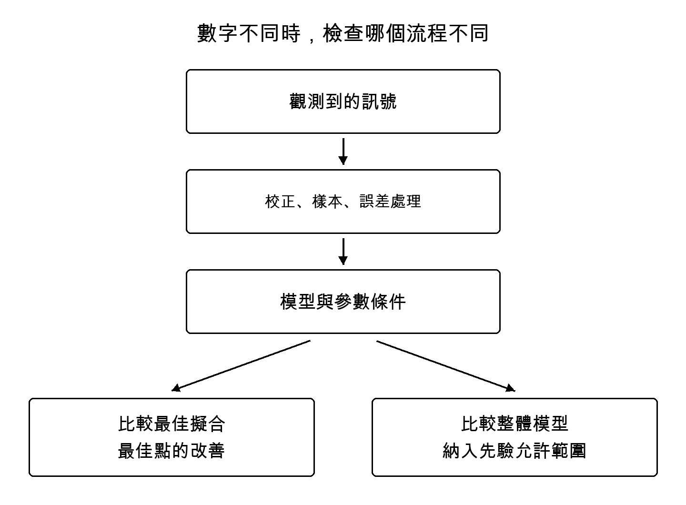

# 第4章 宇宙的加速會改變嗎

思考暗能量時，區分兩個問題會更清楚：為解釋宇宙膨脹，需要假設什麼成分或重力作用？這些成分或作用是否隨時代變化？2026年的研究更細緻地追問後者，但尚不能說變化已獲確認。

## 測量膨脹歷史的尺

早期宇宙中，物質與光的交互作用留下了波的痕跡，保存於後來的天體分布等資料。這種稱為重子聲學振盪、簡稱BAO的線索，讓我們能比較不同時代的距離尺度。

這不是把尺貼在天空直接讀出公分，而是從角度與紅移方向的分布，限制距離和膨脹率的組合。如何處理尺的基準長度、如何與其他觀測結合，都會改變所得限制。

遠方類星體的光，帶有沿途氫氣吸收光線留下的細微圖樣。收集大量資料研究相關性，就能取得早期至中期宇宙幾何的資訊。我們看到的，不只是小光點的照片，也是刻在光路上的宇宙結構。

## DESI的新測量

DESI在2026年的論文利用稱為萊曼α森林的吸收相關性，精確限制有效紅移2.33處的幾何。在以兩個參數表示暗能量隨時間變化的模型中，DESI與背景輻射的組合報告2.7σ的偏好，加入超新星後為3.2σ。[5]

這不等於宇宙常數已遭否定。同一論文也說明，新的高紅移測量點本身與基準Planck ΛCDM相當一致；對時變模型的偏好，來自結合其他時代測量的擬合。若說所有新測量都朝同一方向推進，就偏離了研究內容。[5]

這些區別也許顯得細小。但「宇宙常識已改變」與「在哪些條件下，哪種解釋稍微更吻合」之間，關係到讀者能否接續研究。

## 先限定變化形狀的優點與弱點

研究變化，必須以某種形式表示變化方式。形式過於自由，有限資料就難以限制；反之，過度限定簡單形式，也可能讓我們只找到該形式內的最佳答案，而真實變化其實不同。

Wang與Freese的研究，把暗能量密度或狀態方程在若干紅移點上表示，再於其間插值。結果與宇宙常數一致，並討論表示方法如何影響時變顯著性的評估。研究於2025年投稿及修訂，2026年刊登於JCAP。[6]

標題中的「模型獨立」不代表沒有任何假設。平坦性、選用觀測、插值及先驗條件仍在；分析也未加入超新星。不能把它與DESI另一種組合的數字並列，當成簡單的贊成或反對票。[6]

我由此學到的，不是立即選出勝者，而是調查差異從何而來：共享哪些觀測？新增哪些資訊？允許什麼變化方式？若不對齊這些條件，就不清楚論文間的不一致代表什麼。

DESI本身也不只測試單一雙參數公式。擴展分析比較了分段表示與高斯過程方法。[47] 因此，把時變跡象直接斥為「選了一條公式造成的錯覺」，也為時過早。必須閱讀不同表示的比較做到哪裡，以及觀測組合如何不同。

## 增加觀測與修正校正

即使用同一批超新星，測光基準或處理顏色與距離關係的模型若改變，距離估計也會變。2026年的DES-Dovekie重新分析更新了測光交叉校正與誤差處理，對時變的支持比舊分析減弱；所採組合報告約五比一的弱貝氏因子。[41]

這不是新發現天體單憑數量抵銷舊結果，而是把觀測連到距離的流程得到修正。沒有儀器能從測得數字直達世界性質；更細緻的校正也會推進理解。

另一方面，Watkins等人的2026年預印本關注近、遠超新星間的系統偏移，探討與標準模型的一致性。[43] 這是包含小樣本比較的未審查分析，不能當成所有問題已解決。距離歸一化與哈伯常數的簡併也須注意：超新星擬合得到的歸一化數字，不能直接拿來與獨立的絕對哈伯常數測量相比。

## 三個標準差與非決定性證據

Lozano Torres在2026年的分析，使用包含更新超新星資料的組合，同時報告時變模型改善擬合，以及不具決定性的貝氏模型比較。[42] 兩者回答不同問題：最佳參數的擬合改善程度，與考慮先驗允許的整體範圍後對模型的支持，不是同一個數。

貝氏比較也依賴採用的先驗分布及其證據估計。不能把使用不同資料集的論文之σ並排，然後選較大的。[第12章](12_evidence.xhtml)將用簡單計算說明：即使最佳擬合相同，整體模型比較也可能改變。

## 重力透鏡帶來的另一條路

哈伯常數描述宇宙目前的膨脹速度。把早期宇宙觀測套入基準模型所得的值，與較近期宇宙觀測所得的值有差距，稱為哈伯張力。

TDCOSMO在2026年10月的預印本，使用11個重力透鏡所造成的類星體多重影像之抵達時間差等資訊。基準分析採用平坦ΛCDM及來自超新星資料的物質密度條件，得到哈伯常數71.1，上下誤差分別為2.4與2.3公里每秒每百萬秒差距。[7]

這並非直接重用局部距離階梯。但因此稱它完全獨立於所有其他觀測，也不準確。明示基準結果加入哪些外部條件，很有意義。相關討論論文比較排除其他測量的組合，同樣指出：若只用透鏡方法判定張力，還需要提高精度。[8]

這兩篇是同一研究的測量與討論，不是兩次獨立發現。論文篇數不能直接當作證據份數。

## 最前線並非完成品的陳列

上述研究不是什麼都無法決定的停滯。可比較的觀測增加，誤差來源處理得更細，模型允許的自由度也受到檢查。解釋獲得支持的範圍，以及支持會改變的條件，都更清晰了。

但單憑2026這個較新年份，不能說它比所有舊研究都可靠。增加觀測、重新分析同一觀測、提出尚未測試的方法，各有不同角色。最前線不是依新舊排列的確定答案書架，也是一個公開檢討過程的地方。

知道暗能量的身分，對理解宇宙未來很重要。但把有限時期的限制外推到遙遠未來，就必須承擔外推假設。從變化跡象到確定宇宙結局，中間還有許多橋要架。
