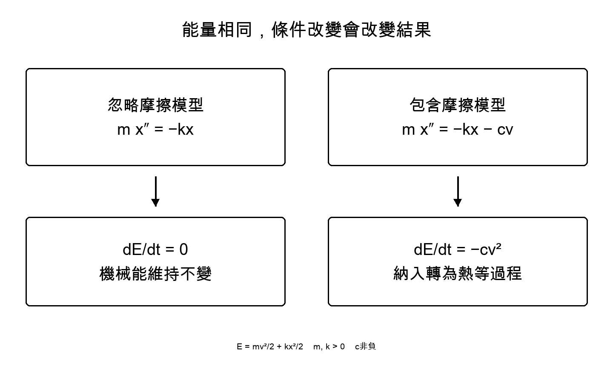

# 第15章 用數學看見變化中保留的事物

思考本質時，我們常在可見外貌之後尋找不變者。物理把部分願望化成具體問題：什麼在何種條件下守恆？什麼關係保持形式？拿掉條件又會改變什麼？

本章從小彈簧出發，不是把宇宙當彈簧，而是練習連接定義、預測、驗證與界限。之後再走向守恆律與宇宙膨脹。

## 數字帶著所計數的事物

長度2加時間3得5，無法界定是什麼量。長度伴隨公尺、時間伴隨秒。改單位時物理關係不變的寫法很重要；國際單位制SI提供共同基準。[58]

檢查量綱能找出部分公式錯誤。速度是長度除時間，加速度再除時間。但量綱對，不保證定律正確；係數與函數形式仍須決定並對照觀測。

文章邏輯也類似：詞語類別不合，就接不起來；類別合，也不保證整個主張正確。量綱檢查是好的第一步，不是充分條件。

## 彈簧預測的運動

在線上把質量m掛於彈性常數k的彈簧。x是偏離平衡的位移，t是時間，v是速度。m、k正且固定，忽略摩擦與外力，伸長小到力可寫−kx。運動方程是：

**m d²x/dt² = −kx**

負號表示力朝向平衡。滿足方程的一種解為：

**x(t) = A cos(ωt + φ)，ω² = k/m**

A是振幅，φ是表示初態的相位。兩次微分使cos乘−ω²，便回到原方程。因此回到相同位置與速度的週期T為：

**T = 2π √(m/k)**

m為1公斤、k為4牛頓每公尺時，T是π秒，約3.14秒。這是模型設定，不是實測。

如此，「會振盪」成為可隨條件改變而檢查的預測。質量乘4、k不變，週期乘2；理想模型內改振幅不改週期。若真彈簧不符後者，就檢查伸長是否過大、其他效應是否可忽略。

數學沒有不用實驗就判定假設正確，而是清楚顯示假設成立會推出什麼，於是有了與現實比較之處。

## 不只口頭說守恆，也用計算檢查

定義模型能量：

**E = mv²/2 + kx²/2**

前項動能，後項彈簧位能。位置改變，分配改變，合計呢？

因v = dx/dt，時間微分得到：

**dE/dt = mv dv/dt + kx dx/dt = v(m d²x/dt² + kx) = 0**

最後等號使用起初運動方程。由微分、速度定義、運動方程依次接到守恆，不是定義本身就推出守恆。

加上反向摩擦力−cv，令c≥0。方程右邊變−kx−cv，同樣計算得到：

**dE/dt = −cv² ≤ 0**

彈簧與質量的E減少。把摩擦對象也包含，失去的機械能轉為熱等形式。系統包含什麼、排除什麼，決定守恆陳述的範圍。

## 對稱性與守恆律

實驗今天或明天開始、平移位置、旋轉方向，定律形式仍相同。諾特第一定理連結這類連續對稱與守恆量。在以作用量描述力學的適當條件下，時間平移對應能量守恆，空間平移對應動量，旋轉對應角動量。[53][52]

這以共同數學連起看似零散的守恆律。但泛稱「任何對稱直接帶來守恆」會丟失條件。處理可逐位置改變的局部對稱之第二定理，有運動方程間恆等關係的不同角色。

Barros e Sá等人的2026年論文整理：由第二定理導出共變守恆律，需要作用量分離等額外條件。[52] 忽略第一與第二差別，只說對稱所以守恆，就遮住了想了解的接點。

我眼中的美，不是一個詞解釋一切，而是在條件下釐清：容許哪些變化仍相同，會連到哪種守恆。

## 走向膨脹宇宙

以a(t)表示尺度因子。大尺度均勻、各向同性宇宙以廣義相對論處理，成分視為完美流體，宇宙常數也含入流體時，加速度方程為：

**(d²a/dt²)/a = −(4πG/3) Σ(ρ + 3p/c²)**

G是重力常數，c是光速，ρ是換算成質量密度的能量密度，p是壓力，Σ表示成分相加。若另一寫法把宇宙常數列左邊或另項，勿重複計算。[1]

單一正密度成分令w = p/(ρc²)，符號取決於1 + 3w。w小於−1/3，單成分模型就加速。忽略壓力的物質w為0，輻射為1/3，宇宙常數作流體為−1。多成分時要看各密度與合計，不只一個w。

負壓可能不合日常直覺，但仍能追蹤公式意義與觀測關係。公式沒有決定暗能量身分，而是顯示觀測要限制哪些組合。

整個宇宙通常沒有彈簧例子中的全域時間平移對稱。局部能量動量共變守恆，與為全宇宙定義一個守恆總能量，不可等同。把日常直覺搬向宇宙時，數學也會重新問條件。

## 沿關係追尋本質

為何有定律、為何是這套定律，並未全解。但已前進一步：從觀看變化，到預測條件改變，並尋找變化中保留的關係。

一條追尋本質的路，是從可檢查範圍連起這些關係。不一開始命名終極實體，而是問如何改動仍保留、哪裡不再保留，再追尋比現模型更深的解釋。
