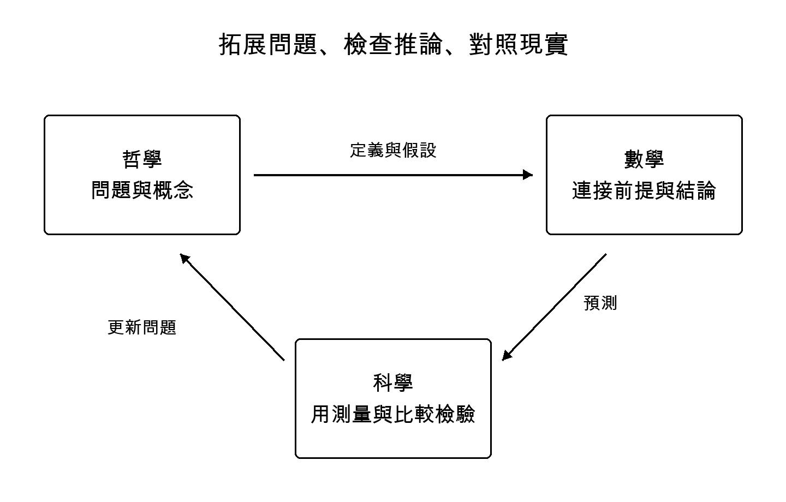

[從開頭結論讀起](00_conclusions.md#h-1) ｜ [目錄](../README.md#toc) ｜ [參考文獻](19_references.md#h-1) ｜ [下一章](01_truth.md#h-1)

# 前言 先讀結論

我們還不能用一個答案，為宇宙的本質畫上句點。但這並不表示我們一無所知。藉由解讀遠方傳來的光、測量原子、研究腦的活動，我們已能分辨過去無法區分的解釋。理解宇宙的工作，確實已走到這裡。

這本書裡，我重視的不是答案有多宏大，而是答案與世界相接的地方。什麼觀測讓我們得到這個結論？若換一種解釋，又會有什麼不同？由此，對意識與人生的意義，我們能說些什麼？沿著這些接點，即使面對極其遙遠的問題，也能逐步靠近。

哲學拓展尚未成形的問題。數學檢查既定前提能推出什麼。科學則把解釋與測量、實驗對照。我想借助三者各自的力量追尋真理，而不是讓它們彼此競爭。後半部將從小規模計算出發，探討機率、守恆律與因果關係。

先把本書的全貌交代在前。

## 目前能說的七件事

**第一，關於宇宙歷史的知識，並不是隨意編造的故事。** 我們透過物理模型，對照光譜、宇宙微波背景輻射與天體分布等資料。但透過模型估計宇宙的年齡，與追問存在本身為何存在，是不同的問題。[第2章](02_cosmos.md)將釐清這個區別。

**第二，宇宙的主要成分中，仍有尚未辨明身分的事物。** 暗物質與暗能量，也是給這些待解位置所取的名字。有了名稱，不代表問題已解決，而是待解釋的對象更加明確。我們將在[第3章](03_dark_matter.md)與[第4章](04_dark_energy.md)討論，也包括2026年的新結果。

**第三，量子理論透過實驗，重新挑戰了我們直觀的世界圖像。** 但它並未證明意識能隨心所欲地創造宇宙，也沒有證明相隔遙遠的人的心靈是一體。[第6章](06_quantum.md)將區分實驗帶來的限制與詮釋。

**第四，重力與量子理論的交界，確實存在深刻的未解問題。** 黑洞觀測、關於資訊的計算、實驗提案，並不是同一種類的證據。[第7章](07_gravity.md)與[第8章](08_information.md)也參照2026年10月發表的論文，檢查各種解釋的前提。

**第五，對意識的解釋，正逐漸接受檢驗。** 然而，把針對腦建立的指標轉用到AI，是否就能測量主觀經驗，仍未解決。[第10章](10_consciousness.md)與[第11章](11_ai.md)將分開思考智能高低、對話流暢與是否具有意識。

**第六，描述宇宙的定律，不會自動給出我們應當守護的目的。** 我希望減少可以避免的嚴重痛苦，擴大彼此選擇生活方式的餘地。[第13章](13_meaning.md)把這個願望作為可以共同討論理由的提議，而不是宇宙下達的命令。

**第七，若想靠近本質，除了保留結論，也必須保留結論會改變的條件。** 這不是滿足於軟弱的答案，而是釐清哪一步確實能夠踏出。[第14章](14_inquiry.md)以後將整理具體的探究方法。

## 如何使用「本質」這個詞

本書不把本質當成能解釋一切的魔法詞語，而把它理解為：**連接不同尺度的解釋時，追問什麼得以保留、哪裡需要新的前提。** 這是作者在探究上的立場，不是物理學已經證明的本質定義。

例如，原子的行為、溫度的變化，以及生物感到寒冷，並非互不相關。然而，只要寫出原子的方程式，對寒冷感受的解釋就會自動完成嗎？如果能解釋這種經驗，幫助受寒者的義務，也會從同一組方程式導出嗎？彼此相連，與解釋已經完成，是兩回事。

我們可以在保留聯繫的同時，辨認尚未架起的橋梁。本書從這裡追尋宇宙的本質。

## 問題的起點

前作《思考一切存在的幸福》探討的是：如何不讓任何人的經驗被排除在關懷之外。[[39]](19_references.md#ref-39) 起點是我自身長久的痛苦，以及即便如此，仍不斷想更理解這個世界的歲月。

這次，我把這個目的放在心上，同時將問題轉向外部世界。宇宙是什麼樣的？身為宇宙一部分的我們，為何會有經驗？理解加深之後，能改變什麼？我不把自己的願望當成正確的證據，而希望把願望催生的問題，逐步轉成他人也能檢查的形式。

本書由既有研究的比較考察，以及作者的哲學提議構成。它不是發現新天體的觀測報告，也不是證明宇宙終極理論的論文。我也不主張曾進行獨立實驗或全面重新分析原始資料。因此，我會區分每項研究顯示什麼，以及我由此想到什麼。

## 閱讀與分享

想從宇宙研究讀起，請前往[第2章](02_cosmos.md)；想從意識與AI切入，請讀[第10章](10_consciousness.md)。若對數字的解讀沒有把握，也可以先讀[第12章](12_evidence.md)。每章都能返回結論與目錄，點選本文中的編號即可前往參考文獻。

原創本文及編輯成果，在作者oopdesc擁有權利的範圍內，以CC BY-SA 4.0分享。允許商業利用與改作。請標明作者、書名、版本、來源及修改內容，分享改作時沿用相同條件。[[40]](19_references.md#ref-40) 此授權不包含第三方論文或圖像的權利。詳情見[版權頁](20_colophon.md)。

如果這些問題能在記錄我的名字與起點的同時，離開我的手仍繼續成長，我會很高興。

---

[從開頭結論讀起](00_conclusions.md#h-1) ｜ [目錄](../README.md#toc) ｜ [參考文獻](19_references.md#h-1) ｜ [下一章](01_truth.md#h-1)
