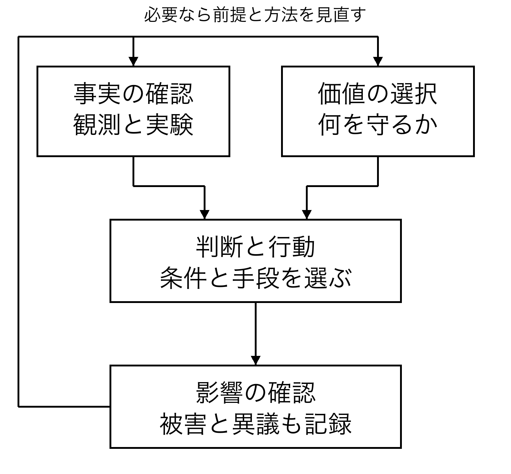

# 結論を先に読む

**この本の原点。** 私自身が長く苦しみを抱えながら、それでも考えることをやめずに生きてきた時間が、この本の出発点にある。どうすれば、自分だけでなく、ほかの存在も望まない苦しみから離れ、大切な生を送れるのか。その問いを重ねてきた経験と思索を、ここに残したい。oopdescの構想と原資料をもとに、調査と本文の執筆・編集にはAIを用いて、一冊にまとめた。

私がこの本で提案するのは、すべての存在の幸福を、他人任せにしない共通の課題にすることだ。自分の望みだけが叶えばよいとは考えない。自分と同じように、誰かにも、その誰かにしか経験できない喜びと苦しみがある。そのことを、社会の仕組みや技術を選ぶときの出発点にしたい。

**誰も配慮の外へ追いやらず、避けられる深刻な苦しみを減らし、それぞれが自分の生を選び直せる条件を、協力して広げる。目的が衝突したときは、相手の存在を否定する代わりに、目的と手段と分配を問い直す。**

これは宇宙が私たちに命じた法則ではない。私が選び、理由を示し、読者に検討してほしいと願う倫理的な提案である。正しいと感じる強さだけでは、その正しさは証明されない。だから、反対意見が入れる場所を残す。

ただし、すべての願いを、その内容を問わず同時に叶えることはできない。誰かを支配したいという願いと、支配されたくないという願いは衝突する。私が出発点としてきた「すべての存在が目的を達成して幸せになる」という理想には、衝突が起きたときの扱いも必要になる。先に述べた結論は、そのために目的と手段と分配を問い直すことを含めている。

**共有する方へ。** 再配布・翻訳・改変などの二次利用では、著者oopdesc・書名・出典を表示し、CC BY-SA 4.0の条件に従ってほしい。[48] 詳細と表示例は奥付に置いた。原著と変更した部分をたどれる形で、次の人へ渡してほしい。

## 本書の答えは三段階にある

第一段階は、いま生きている存在の生活を守ることだ。苦しんでいる人を助け、他者を傷つけずに目的を追える条件を整える。遠い未来の理想のために、現在の誰かを使い捨てにしない。理想へ向かう過程も、理想の一部として扱う。

第二段階は、自分たちの知性と制度と目的を更新することだ。私はこれを自己超越と呼ぶ。自分を消すことでも、休まず成長し続けることでもない。誤りに気づいたときに修正できること、違う立場の人から学べること、以前の自分が見落としていた存在を配慮の中へ迎えられることだ。

第三段階は、存在と意識と宇宙を探究し、問いそのものを深めることだ。私たちは、究極の真理も最終目的も知り尽くしていない。知ることで新しい問いが生まれ、目的も変わるかもしれない。完成した答えを守るために探究するのではなく、答えを更新できるように探究する。

この三段階は、第一を済ませてから第二へ進む階段ではない。助けながら学び、学びながら仕組みを直し、その仕組みの中で次の問いを育てる。宇宙の謎が解けるまで、目の前の苦しみを放置する必要はない。目の前の問題に向き合うために、宇宙への好奇心を捨てる必要もない。

## 何を根拠にしているのか

本書は四種類の文を区別する。

**経験的な知見**は、観測や実験や調査によって支持される説明だ。どの対象を、どの方法で調べたかによって、言える範囲が決まる。人間の幸福に関する調査が、そのまま動物やAIの経験を測ったことにはならない。

**価値の選択**は、何を大切にするかという立場だ。苦しみを減らすこと、他者の自由を守ること、理由のない差別を避けることを、本書は大切にする。これらは、数式の答えとして自動的に出てくるものではない。

**条件つきの推論**は、前提を受け入れれば何が導かれるかを示すものだ。たとえば、一人ひとりの苦しみに配慮すると決めたなら、全体の平均が上がるという理由だけで、少数者の深刻な被害を無視することは、その決定と整合しない。

**未検証の哲学的仮説**は、いまの観測だけでは決着しない考えだ。すべての主観が根底で一つなのか、宇宙全体が自己超越しているのか、存在に最終目的があるのか。本書はこれらを考える。しかし、考えられることと、事実であることは分ける。

この区別は、夢を小さくするためではない。どこを調べれば理解が進むのかを、見えるようにするためにある。言葉の印象を強くすることと、知識を増やすことは別の作業だ。

## いま行動を選ぶなら

本書の立場から、限られた時間や資源を使う順序を、暫定的に次のように考える。これは、すべての場面へ当てはまる科学的な順位ではない。差し迫った被害、取り返しのつかなさ、証拠の確かさ、当事者の自由を重視するという、価値判断を含む提案である。

| 優先すること | 理由 | 順位を見直す条件 |
| --- | --- | --- |
| 1　まず、差し迫った深刻な被害を防ぐ | 失った生命や自由を後から取り戻せない場合がある | 支援そのものが害を増やす場合は方法を変える |
| 2　次に、本人が選び、協力できる条件を整える | 救済だけでなく、生活を自分で築く余地が要る | 外部への被害や、参加できない人の事情を確かめる |
| 3　その過程で、知識と制度を確かめ直す | 善意だけでは失敗の原因が残る | 証拠の弱い点と、修正の費用を比べる |
| 4　長期には、まだ答えのない問いを探究する | 新しい理解が、将来の選択肢を広げうる | 遠い利益の約束で現在の人を犠牲にしない |

この順序は、基礎研究を後回しにしてよいという意味でも、目先のことだけを考えるという意味でもない。研究を続けながら、いま守れる生活を守る。何を優先するかに意見が分かれたときは、この表を権威として使わず、前提に戻って話し合いたい。

## 結論と本文をつなぐ道案内

「なぜ自分以外の幸福まで考えるのか」は、[第1章の配慮の理由](01_苦しみ.md#私の経験から他者の経験へ)と、[第3章の配慮の範囲](03_全存在.md#配慮の対象を見失わない)で説明する。苦しみの経験から出発し、配慮の理由と、その対象を検討する。

「みんなの目的が違うのに協力できるのか」は、[第4章の目的の衝突](04_目的の衝突.md#他者を害する目的をどう扱うか)、[第8章の協力の条件](08_協力.md#共通目的があっても残る問題)、[第9章の決め方](09_自由と決定.md#全員が納得する決め方はあるか)で扱う。願いの衝突を隠さず、協力を支える条件と、自由を守る決め方を考える。

「幸福や知性をどう理解するのか」は、[第5章の幸福の測定](05_幸福の測定.md#幸福という一語をほどく)、[第7章の知性の限界](07_知性.md#問題を知性だけで説明しない)、[第10章のAIと学習](10_AIと目的.md#答えを得ることと学ぶこと)、[第11章のAIの経験](11_AIの経験.md#指標を数えれば答えが出るのか)、[第12章の意味](12_意味.md#意味はどこから来るのか)へ進める。自分と他人の関係、AIの能力と経験の違い、生きる意味を検討する。

「権威や強い確信に従わずに生きられるか」は、[第13章の権威と理由](13_権威と自律.md#権威の強さと理由の強さ)と、[第14章の目的の更新](14_自己超越.md#更新の対象には目的も含まれる)で考える。論理の役割と限界を踏まえ、自律と自己超越を位置づける。

「哲学をどこまで科学にできるのか」は、[第15章の数理モデル](15_協力のモデル.md#全員で出す方がよいのに出さなくなる)、[第17章の検証](17_検証.md#何を確かめたいのかを狭くする)、[第18章の意識研究](18_意識.md#競合する説明を比べる)、[第19章の宇宙論](19_宇宙.md#観測できる宇宙と存在のすべて)、[第20章の数学の範囲](20_論理の限界.md#形式的な証明と世界の正しさ)で扱う。小さな数理モデル、検証可能な仮説、意識研究、宇宙論、数学が保証できる範囲を順に示す。計算例は架空のものであり、現実の実験結果ではない。

「読み終えて何をすればよいのか」は、[第21章の共有](21_共有.md#改訂できる本にする)、[第22章の実践例](22_実践.md#架空の学習会を設計する)、[第23章の反論](23_反論.md#幸福を共通目的にすること自体が支配ではないか)、[第24章の次の問い](24_次の問い.md#最初の目的へ戻る)へ進める。情報の共有、日々の実践、この思想への反論、次の探究へとつなぐ。付録には論証の見取り図と数理的な証明、研究計画、用語と出典を置いた。

## この本が読者に求めないこと

この本への同意は、協力の参加資格ではない。特定の宗教観も、AIへの信頼も、宇宙についての一つの解釈も必要ない。読者が自分の生活や大切な人を犠牲にして、巨大な使命を背負う必要もない。

本書を読む価値は、著者の結論を覚えることだけにあるのではない。自分ならどの前提を受け入れるか。何が確かめられれば考えを変えるか。誰の声がまだ入っていないか。そうした問いを、自分の言葉で持てるようになることにある。

私は、世界が変わるという約束を、この本の価値の保証にしたくない。代わりに、一つの主張に理由をつけ、一つの理由に限界を示し、限界があれば次に調べることを示したい。読者がその作業を引き継げる本をつくる。そのことから始める。
