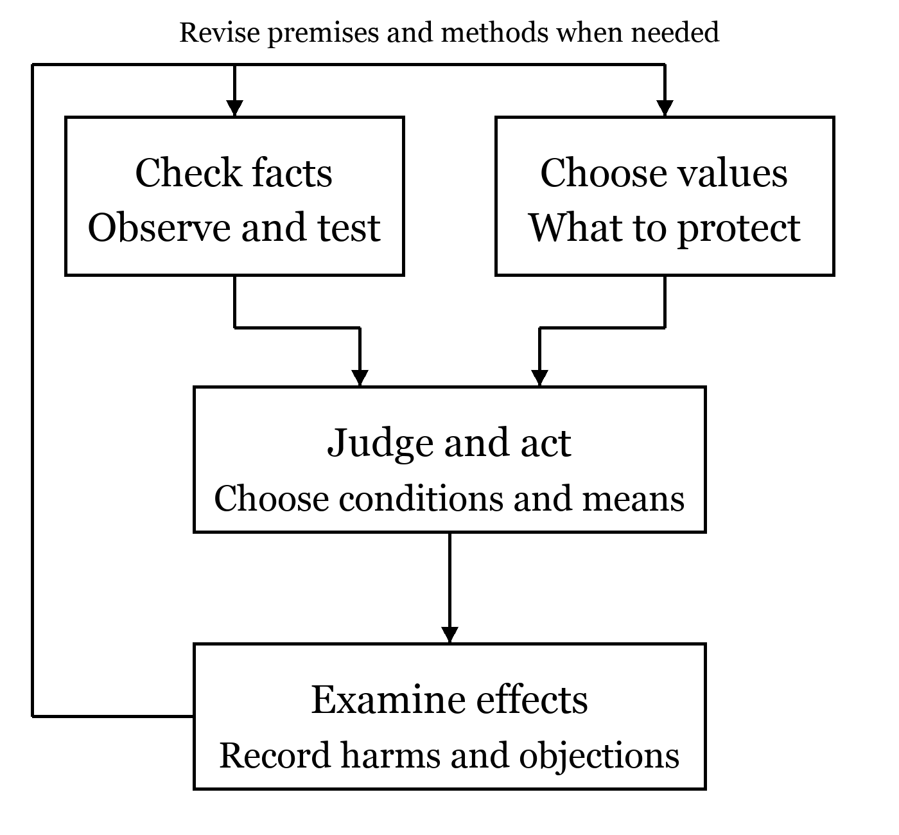

# Read the Conclusions First

**Where this book began.** This book begins in the years I spent living with suffering and continuing to think nonetheless. How might not only I, but other beings too, find relief from unwanted suffering and lead lives that matter to them? I want to preserve the experience and reflection behind that question. Drawing on oopdesc's conception and source materials, I used AI for research, writing, and editing to bring this book together.

My proposal is to make the happiness of all beings a shared concern rather than leave it to someone else. The fulfillment of my own wishes is not enough. Others, like me, have joys and suffering that only they can experience. I want that recognition to be a starting point when we choose our institutions and technologies.

**Exclude no one from consideration. Reduce avoidable, severe suffering. Work together to expand the conditions in which each can reconsider and choose their own life. When purposes conflict, reconsider the purposes, means, and distribution instead of denying the other's standing.**

This is not a law the universe has commanded us to obey. It is an ethical proposal I choose, give reasons for, and ask readers to examine. The strength of a conviction does not prove it right. There must therefore be room for disagreement.

We cannot, however, fulfill every wish simultaneously without regard to its content. A wish to dominate someone conflicts with that person's wish not to be dominated. My starting ideal, that all beings fulfill their purposes and become happy, needs an account of such conflicts. The conclusion above includes reconsidering purposes, means, and distribution for that reason.

**For those who share this work.** When redistributing, translating, adapting, or otherwise reusing it, please identify the author oopdesc, the title, and the source, and follow CC BY-SA 4.0.[48] Details and an attribution example appear in the colophon. Pass it on in a form that lets others trace the original work and your changes.

## The Answer Has Three Stages

The first is to protect the lives of beings living now: help those who suffer and establish conditions in which people can pursue purposes without harming others. Do not discard someone today for an ideal in the distant future. The path toward the ideal is itself part of the ideal.

The second is to revise our intelligence, institutions, and purposes. I call this self-transcendence. It means neither erasing oneself nor growing without rest. It means being able to correct mistakes, learn from differently situated people, and bring previously overlooked beings within our concern.

The third is to investigate existence, consciousness, and the universe, deepening the questions themselves. We do not know ultimate truth or a final purpose exhaustively. Knowledge may bring new questions and alter our purposes. Inquiry should make answers revisable, rather than defend a finished answer.

These stages are not steps that require finishing the first before beginning the second. We learn while helping, improve institutions while learning, and cultivate further questions within them. We need not neglect nearby suffering until the universe's mysteries are solved. Nor need we abandon curiosity about the universe to address immediate problems.

## What Supports These Claims

This book distinguishes four kinds of statement.

**Empirical findings** are explanations supported by observation, experiment, or surveys. What we may conclude depends on whom or what was studied and how. A survey of human well-being does not thereby measure animal or AI experience.

**Value commitments** state what matters. This book values reducing suffering, protecting others' freedom, and avoiding unjustified discrimination. These do not emerge automatically as the answers to equations.

**Conditional reasoning** shows what follows if premises are accepted. If we commit to considering each person's suffering, ignoring severe harm to a minority merely because the overall average rises is inconsistent with that commitment.

**Unverified philosophical hypotheses** are ideas not settled by present observation: whether all subjectivity is fundamentally one, whether the universe as a whole transcends itself, or whether existence has a final purpose. This book considers them while distinguishing conceivability from fact.

These distinctions are not meant to diminish our aspirations. They show where investigation might improve understanding. Making words more impressive and increasing knowledge are different tasks.

## If We Must Choose an Action Now

From this book's standpoint, the following is a provisional order for using limited time and resources. It is not a scientific ranking applicable everywhere. It includes value judgments that emphasize imminent harm, irreversibility, the strength of evidence, and affected people's freedom.

| Priority | Reason | When to reconsider |
| --- | --- | --- |
| 1. Prevent imminent, severe harm | Lost life or freedom may be impossible to restore | Change the method if assistance itself increases harm |
| 2. Establish conditions for choice and cooperation | People need room to build their lives, as well as relief | Check harm to others and the circumstances of those unable to participate |
| 3. Reassess knowledge and institutions along the way | Good intentions alone leave causes of failure intact | Compare uncertain evidence with the costs of correction |
| 4. Pursue unanswered questions over the long term | New understanding may expand future options | Do not sacrifice people now for promised distant benefits |

This order does not license neglect of basic research or concern only with immediate matters. Continue inquiry while protecting lives we can protect now. When priorities are disputed, return to the premises and discuss them rather than treat this table as an authority.

## A Guide from Conclusions to Reasons

Why consider happiness beyond one's own? See [the reasons for concern in Chapter 1](01.md#s3) and [its scope in Chapter 3](03.md#s2). Starting from the experience of suffering, we examine reasons for concern and whom it should include.

Can people cooperate when their purposes differ? See [conflicting purposes in Chapter 4](04.md#s4), [conditions for cooperation in Chapter 8](08.md#s3), and [decision procedures in Chapter 9](09.md#s3). We acknowledge conflicting wishes and examine cooperation and decisions that protect freedom.

How should we understand happiness and intelligence? See [measuring well-being in Chapter 5](05.md#s2), [intelligence's limits in Chapter 7](07.md#s3), [AI and learning in Chapter 10](10.md#s8), [AI experience in Chapter 11](11.md#s4), and [meaning in Chapter 12](12.md#s2). We examine self and others, AI capability versus experience, and meaning in life.

Can we live without obeying authority or strong conviction? See [authority and reasons in Chapter 13](13.md#s3) and [revising purposes in Chapter 14](14.md#s4). Autonomy and self-transcendence are considered alongside the uses and limits of logic.

How far can philosophy become science? See [mathematical models in Chapter 15](15.md#s3), [testing in Chapter 17](17.md#s2), [consciousness research in Chapter 18](18.md#s3), [cosmology in Chapter 19](19.md#s2), and [mathematics' scope in Chapter 20](20.md#s5). We move through small models, testable hypotheses, consciousness, cosmology, and what mathematics can guarantee. Numerical examples are fictional, not real experimental results.

What can we do after reading? See [sharing in Chapter 21](21.md#s7), [practical examples in Chapter 22](22.md#s3), [objections in Chapter 23](23.md#s2), and [further questions in Chapter 24](24.md#s2). These connect sharing, everyday practice, criticism, and further inquiry. The appendices provide an argument map, mathematical proofs, research plans, terminology, and sources.

## What This Book Does Not Ask of You

Agreement with this book is not a qualification for cooperation. No particular religious outlook, trust in AI, or interpretation of the universe is required. Readers need not sacrifice their own lives or loved ones to carry an enormous mission.

Reading is valuable beyond memorizing the author's conclusions. Which premises would you accept? What findings would change your mind? Whose voice is still missing? Its value lies in being able to ask such questions in your own words.

I do not want a promise to change the world to serve as a guarantee of this book's worth. Instead, I want to give each claim a reason, identify each reason's limits, and indicate what to investigate next when a limit is reached. I begin by making a book whose work readers can continue.
