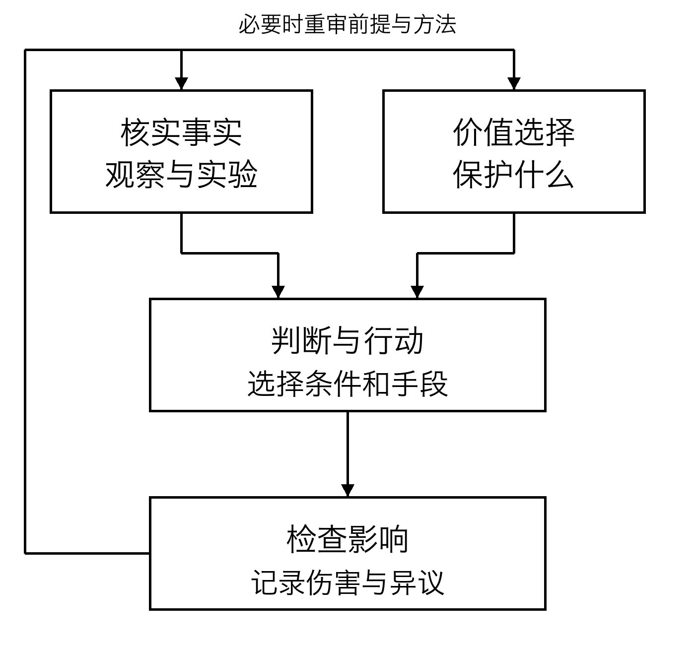

# 先读结论

**本书的起点。** 我长久地承受痛苦，却仍未停止思考、继续生活的那些岁月，是本书的起点。怎样才能让自己，也让其他存在，远离不愿承受的痛苦，过上珍视的生活？我想留下不断追问这一问题的经历与思考。本书以 oopdesc 的构想和原始资料为基础，使用 AI 协助研究、撰写和编辑，汇成一册。

我的提议是：把一切存在的幸福变成共同面对的课题，而不是留给别人处理。我不认为只要自己的愿望实现就够了。和我一样，其他人也有只有自己才能经历的喜悦与痛苦。我希望把这一点作为选择社会制度与技术的起点。

**不把任何人排除在关怀之外，减少可以避免的严重痛苦，共同扩大每个存在重新选择自己生活的条件。目的发生冲突时，不是否定对方的存在，而是重新审视目的、手段与分配。**

这不是宇宙命令我们遵守的法则，而是我所选择、愿意说明理由并请读者检验的伦理提案。觉得某事正确的强烈程度，不能证明它正确。因此，必须为反对意见保留位置。

不过，不问内容就同时实现所有愿望是不可能的。想支配别人的愿望，与不愿被支配的愿望会冲突。我最初提出的“一切存在实现目的并获得幸福”的理想，也需要处理冲突的方法。前面的结论因此包含对目的、手段和分配的重新审视。

**致分享本书的读者。** 再分发、翻译、改编等再利用时，请注明作者 oopdesc、书名与来源，并遵守 CC BY-SA 4.0。[48] 详细说明与署名示例见版权页。请让后来者能够追溯原作和修改的部分。

## 本书的回答分为三个阶段

第一阶段是保护当下存在者的生活：帮助受苦的人，创造不伤害他人也能追求目的的条件。不为遥远未来的理想抛弃现在的某个人。通向理想的过程也是理想的一部分。

第二阶段是更新我们的智能、制度与目的。我将其称为自我超越。它既不是消灭自我，也不是不停成长，而是发现错误时能够修正，向不同立场的人学习，并把过去忽视的存在纳入关怀。

第三阶段是探索存在、意识与宇宙，深化问题本身。我们并未穷尽终极真理或最终目的。理解可能带来新问题，也可能改变目的。探究不是为了守住已经完成的答案，而是为了使答案能够更新。

三个阶段并非完成第一层才能迈向第二层的台阶。我们一边帮助一边学习，一边学习一边改进制度，并在其中培育下一个问题。不必等宇宙之谜解开才关心眼前的痛苦，也不必为面对眼前的问题而放弃对宇宙的好奇。

## 依据是什么

本书区分四类陈述。

**经验性发现**是由观察、实验或调查支持的解释。能说到什么程度，取决于研究对象与方法。关于人类幸福的调查，并不等于测量了动物或 AI 的体验。

**价值选择**是对何者重要的立场。本书重视减少痛苦、保护他人的自由、避免没有正当理由的歧视。这些不会作为方程的答案自动出现。

**有条件的推论**说明接受前提后会得出什么。例如，既然决定关心每个人的痛苦，就不能仅因为整体平均值上升而忽视少数人遭受的严重伤害，否则便与这一决定不一致。

**尚未验证的哲学假说**是当前观察还无法裁决的想法：所有主观体验是否在根本上为一，整个宇宙是否在自我超越，存在是否有最终目的。本书会思考这些问题，但区分“可以设想”与“确为事实”。

这种区分不是为了缩小梦想，而是让我们看清调查哪里能增进理解。增强措辞的感染力与增加知识，是不同的工作。

## 如果现在就要选择行动

从本书的立场出发，有限时间与资源的使用顺序，可以暂定如下。这不是适用于所有场景的科学排名，而是包含价值判断的提案，重视迫近的伤害、不可逆性、证据的可靠程度以及当事人的自由。

| 优先事项 | 理由 | 重新审视的条件 |
| --- | --- | --- |
| 1 先防止迫近的严重伤害 | 失去的生命或自由可能无法追回 | 如果帮助本身增加伤害，就改变方法 |
| 2 再创造本人能够选择与合作的条件 | 除了救济，也需要亲手建设生活的空间 | 确认对外部的伤害，以及无法参与者的处境 |
| 3 在过程中检验知识与制度 | 仅有善意会留下失败的原因 | 比较证据的薄弱处与修正成本 |
| 4 长期探索尚无答案的问题 | 新理解可能扩大未来的选择 | 不以遥远利益的承诺牺牲当下的人 |

这个顺序不意味着可以忽视基础研究，也不意味着只顾眼前。继续研究，同时保护现在能够保护的生活。优先顺序有争议时，不把表格当权威，而是回到前提展开讨论。

## 从结论找到正文中的理由

“为什么还要考虑自己以外的幸福？”见[第1章关怀的理由](01.md#s3)与[第3章关怀的范围](03.md#s2)。从痛苦体验出发，考察关怀的理由与对象。

“大家的目的不同，还能合作吗？”见[第4章目的的冲突](04.md#s4)、[第8章合作的条件](08.md#s3)、[第9章决策方法](09.md#s3)。不掩盖愿望的冲突，思考合作的条件与保护自由的决策方式。

“如何理解幸福与智能？”见[第5章幸福的测量](05.md#s2)、[第7章智能的限度](07.md#s3)、[第10章 AI 与学习](10.md#s8)、[第11章 AI 的体验](11.md#s4)、[第12章意义](12.md#s2)。考察自我与他人的关系、AI 能力与体验的区别，以及生活的意义。

“能否不服从权威或强烈确信而生活？”见[第13章权威与理由](13.md#s3)及[第14章目的的更新](14.md#s4)。结合逻辑的作用与局限，讨论自主与自我超越。

“哲学能在多大程度上成为科学？”见[第15章数学模型](15.md#s3)、[第17章验证](17.md#s2)、[第18章意识研究](18.md#s3)、[第19章宇宙学](19.md#s2)、[第20章数学的范围](20.md#s5)。依次介绍小型数学模型、可检验假说、意识研究、宇宙学及数学能够保证的范围。计算例是虚构的，并非现实实验结果。

“读完以后该做什么？”见[第21章分享](21.md#s7)、[第22章实践例](22.md#s3)、[第23章反对意见](23.md#s2)、[第24章下一个问题](24.md#s2)。从信息分享、日常实践、对本思想的批评，走向下一步探索。附录提供论证图、数学证明、研究计划、术语与出处。

## 本书不要求读者做什么

同意本书不是参与合作的资格条件。不需要特定宗教观，不需要信任 AI，也不需要接受某种宇宙解释。读者不必牺牲自己的生活或珍视的人，背负宏大的使命。

阅读的价值不只是记住作者的结论，而是能用自己的话提出问题：我愿接受哪些前提？什么发现会让我改变看法？谁的声音还没有进入讨论？

我不想用改变世界的承诺来保证本书的价值。我希望为每个主张说明理由，为每个理由指出限度，遇到限度就说明下一步应调查什么。先从写出一本读者能够接续其工作的书开始。
